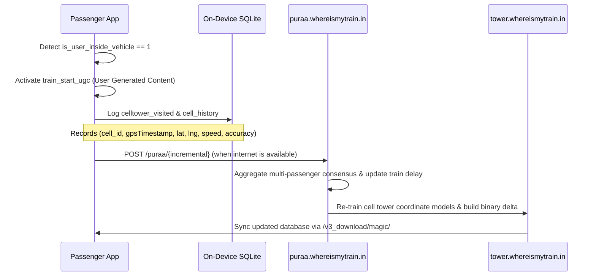

# Where Is My Train (Google / Sigmoid Labs): Architecture & Reverse Engineering Teardown

## 1. Executive Summary

Where Is My Train (package: `com.whereismytrain.android`, version: `7.1.5.974952539`) is India's most popular railway tracking application. Originally created by Sigmoid Labs and acquired by Google in December 2018, its core technological breakthrough is **completely offline train tracking without active GPS or internet connection**.

While government systems like NTES rely on station-master manual entries and ISRO RTIS relies on satellite-connected locomotive hardware, Where Is My Train pioneered a hybrid model combining:
1. **Offline GSM/LTE Cell-Tower Database** matching visible base transceiver stations (BTS).
2. **On-device Sensor Fusion** (3-axis accelerometer and gyroscope vibration pattern recognition).
3. **High-density Crowdsourced Telemetry Relay** uploading real-time positions when passengers regain connectivity.

---

## 2. The Offline Cell-Tower Triangulation Engine

### 2.1 Cellular Base Station Polling
The app queries the Android operating system using `TelephonyManager.getAllCellInfo()` to inspect visible cell towers without initiating any network connection:

```
+-------------------------------------------------------------+
|               Android TelephonyManager                      |
|                  getAllCellInfo()                           |
+------------------------------+------------------------------+
                               |
        +----------------------+----------------------+
        |                      |                      |
        v                      v                      v
+---------------+      +---------------+      +---------------+
| CellInfoGsm   |      | CellInfoLte   |      | CellInfoWcdma |
| - MCC / MNC   |      | - MCC / MNC   |      | - MCC / MNC   |
| - LAC (16-bit)|      | - TAC (16-bit)|      | - LAC (16-bit)|
| - CID (16-bit)|      | - CI  (28-bit)|      | - UCid (28-bit|
+---------------+      +---------------+      +---------------+
```

Each unique base station creates a compound key:
`cellinfo = "{MCC}_{MNC}_{LAC}_{CID}"` (e.g., `404_45_1204_49182`).

### 2.2 The Offline Mapping Table (`cellinfoToLatLng`)
Reversed directly from the compiled Android DEX strings (`classes2.dex`), the app maintains an internal SQLite mapping table:

```sql
CREATE TABLE if not exists cellinfoToLatLng (
    cellinfo varchar(126),
    lat float,
    lng float,
    accuracy int,
    primary key(cellinfo)
);

-- Real-time lookup query executed on cell change:
SELECT cellinfo, lat, lng, accuracy FROM cellinfoToLatLng WHERE cellinfo = ?;
```

When a train is in motion, the device switches base stations every few minutes. By querying this table offline, the application establishes the train's geographic coordinate `(lat, lng)` along the pre-indexed railway track polygon without draining battery on satellite GPS lock.

### 2.3 Google S2 Geometry Spatial Indexing
To scale spatial lookups across India's millions of cell towers, the engine organizes base stations into hierarchical cells using Google's S2 Geometry library (`com.whereismytrain.datamodel.cityconfig.S2CellInfoConfig`). Cell towers along the same railway section share common S2 Hilbert-curve tokens, enabling fast radial searches and route trajectory projection.

---

## 3. Sensor Fusion & In-Vehicle Detection

How does Where Is My Train know a user is actually *inside* a moving train rather than sitting in a nearby car, bus, or station waiting room? It runs continuous on-device sensor fusion.

### 3.1 Sensor Telemetry Schemas
The following tables are maintained locally in the app's Room/SQLite persistence layer:

#### A. Accelerometer Data (`accelerometer_data`)
```sql
CREATE TABLE IF NOT EXISTS `accelerometer_data` (
    `timestampMs` INTEGER NOT NULL,
    `user_action_context` BLOB,
    `total_acceleration_ms2` REAL NOT NULL,
    `is_vibrating` INTEGER NOT NULL,
    `linear_x` REAL NOT NULL,
    `linear_y` REAL NOT NULL,
    `linear_z` REAL NOT NULL,
    `gravity_x` REAL NOT NULL,
    `gravity_y` REAL NOT NULL,
    `gravity_z` REAL NOT NULL,
    `raw_x` REAL NOT NULL,
    `raw_y` REAL NOT NULL,
    `raw_z` REAL NOT NULL,
    PRIMARY KEY(`timestampMs`)
);
```

#### B. Gyroscope Data (`gyroscope_data`)
```sql
CREATE TABLE IF NOT EXISTS `gyroscope_data` (
    `timestampMs` INTEGER NOT NULL,
    `user_action_context` BLOB,
    `total_angular_speed_rad_s` REAL NOT NULL,
    `is_turning_sharply` INTEGER NOT NULL,
    `raw_x` REAL NOT NULL,
    `raw_y` REAL NOT NULL,
    `raw_z` REAL NOT NULL,
    PRIMARY KEY(`timestampMs`)
);
```

#### C. Activity Recognition (`activity_recognition_data`)
```sql
CREATE TABLE IF NOT EXISTS `activity_recognition_data` (
    `timestampMs` INTEGER NOT NULL,
    `user_action_context` BLOB,
    `activity_type` INTEGER NOT NULL,
    `confidence` INTEGER NOT NULL,
    PRIMARY KEY(`timestampMs`)
);
```

### 3.2 Vehicle Disambiguation Logic
- **Train vs Road Vehicle:** Road vehicles make frequent sharp turns at intersections (`is_turning_sharply = 1`). Trains follow rigid track curvatures (`total_angular_speed_rad_s` stays below tight physical thresholds).
- **Train Track Harmonic Signature:** Train movement generates rhythmic rail joint vibrations (`is_vibrating = 1` with characteristic cyclic peaks in `linear_z`).
- **Station Dwell vs En Route:** Accelerometer variance drops to near-zero during station halts and ramps up linearly during locomotive notch acceleration.

---

## 4. Crowdsourcing Telemetry Loop (UGC)

When a passenger is verified to be on board, Where Is My Train turns the device into an active telemetry beacon.



### 4.1 Visited Cell Log Schema (`celltower_visited`)
```sql
CREATE TABLE IF NOT EXISTS `celltower_visited` (
    `id` INTEGER PRIMARY KEY AUTOINCREMENT NOT NULL,
    `celltower_id` TEXT NOT NULL,
    `visited_timestamp_ms` INTEGER NOT NULL,
    `strength` INTEGER NOT NULL,
    `is_registered` INTEGER NOT NULL,
    `train_number` TEXT NOT NULL,
    `train_start_date` TEXT NOT NULL,
    `from_station` TEXT NOT NULL,
    `to_station` TEXT NOT NULL,
    `location_mode` TEXT NOT NULL,
    `gps_timestamp` INTEGER NOT NULL,
    `accuracy` REAL NOT NULL,
    `latitude` REAL NOT NULL,
    `longitude` REAL NOT NULL
);
```

---

## 5. The Proprietary Native C++ Layer (`libHelloJNI.so`)

To protect proprietary cell tower datasets and tracking algorithms from competitor extraction, Where Is My Train compiles core logic into native C++ binaries:

- **Library Path:** `lib/arm64-v8a/libHelloJNI.so`
- **Internal Monorepo Source:** `//third_party/java_src/android_app/wimtclient/trackExp/celltower:libHelloJNI.so`
- **Exported JNI Interface:**
  - `Java_com_whereismytrain_celltower_MyJin_checkJni`
  - `Java_com_whereismytrain_celltower_MyJin_rf` (Read Frodo asset)
  - `Java_com_whereismytrain_celltower_MyJin_gr` (Get Record / decrypt cell coordinates)

The binary embeds Google BoringSSL (`third_party/openssl/boringssl/src/crypto/fipsmodule/cipher/e_aes.cc.inc`) to decrypt obfuscated asset files such as `assets/frodo` (384 KB) and `assets/train_info/boondi` (62 KB) into runtime memory without writing decrypted coordinate databases to disk.

---

## 6. Local Asset Databases Summary

| Asset File | Size | Records | Description |
|---|---|---|---|
| `assets/databases/whereismytrain.db` | 3.9 MB | 13,550 trains / 10,083 stations | Nationwide static metadata, lat/long, soundex indices, Google Place IDs |
| `assets/databases/schedule.db` | 6.3 MB | 29,311 trips / 37,035 stops | Suburban local train timetables (Mumbai, Chennai, Kolkata, Delhi) |
| `assets/train_info/coach_positions.txt` | 566 KB | 13,201 formations | Full rake ordering (LHB/ICF, Loco, EOG, General, Sleeper, 3A, 2A, 1A) |
| `assets/train_info/kodu` | 71.6 KB | 9,414 stations | Platform numbers and track allocations |
| `assets/frodo` | 384 KB | Proprietary binary | Encrypted high-density GSM cell tower geospatial index |
| `assets/local/station_info_{lang}` | ~3.5 MB total | 11 languages | Full phonetic localization across Hindi, Tamil, Telugu, Marathi, etc. |

---

## 7. Network Endpoints Reference

| Host / Path | Protocol | Purpose |
|---|---|---|
| `https://puraa.whereismytrain.in/puraa/{incremental}` | HTTPS / Protobuf | Real-time crowdsourced passenger location ingestion |
| `https://puraa.whereismytrain.in/running_status` | HTTPS / JSON | Online fallback running status query |
| `https://tower.whereismytrain.in/v3_download/magic/` | HTTPS / Gzip | Incremental offline cell tower database update packs |
| `https://tower.whereismytrain.in/v3_download/intracity/local_trains/schematic_map/files/` | HTTPS | Suburban railway schematic vector maps |
| `https://whereismytrain.in/pnr_status/get_pnr_status` | HTTPS / JSON | CRIS PNR status proxy gateway |

